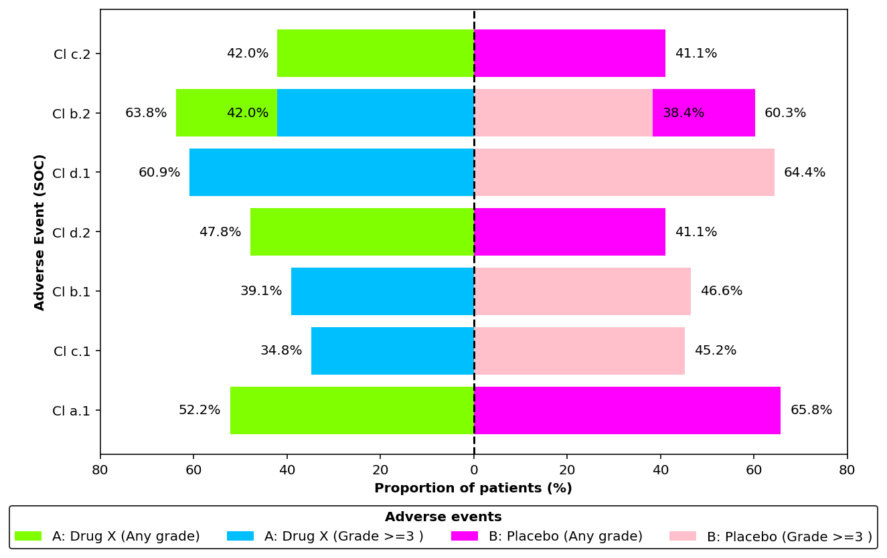
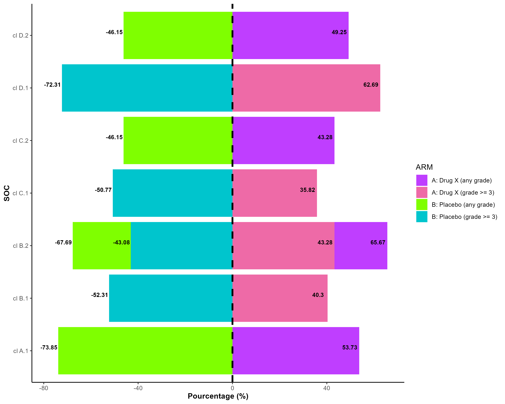
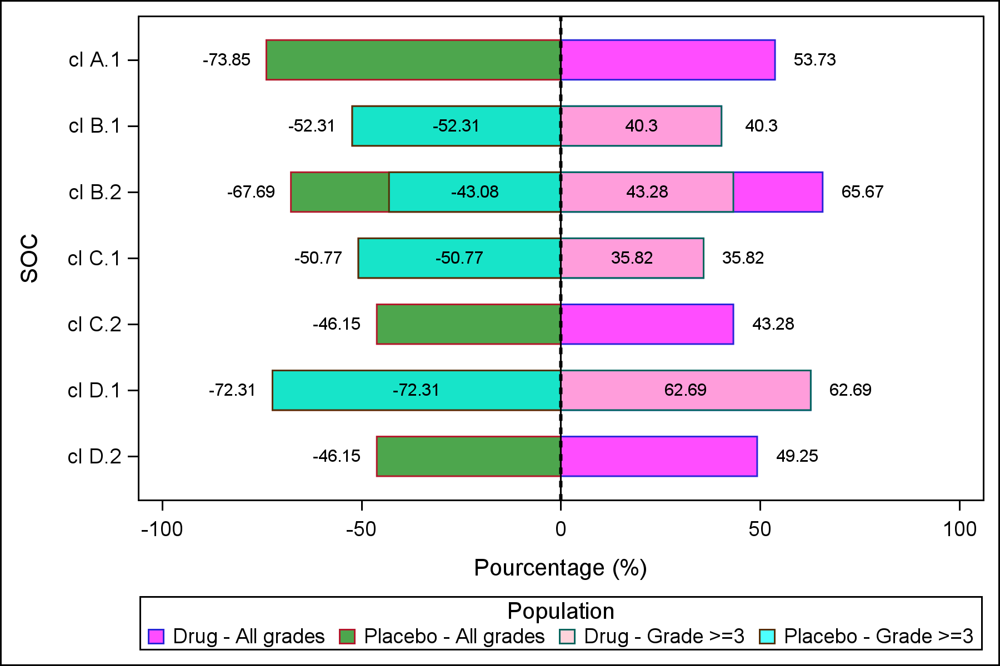

<details style="position: fixed; right: 0; top: 80px; padding: 10px; background: none; width: 350px;">
  <summary style="cursor:pointer;"><strong>📌 About Us</strong></summary>
  
  <u><strong>Links</strong></u>
  
  Personal website (comming soon)

  **contact:** fleurym@ipc.unicancer.fr
  
  <u>**License**</u>

<p xmlns:cc="http://creativecommons.org/ns#" xmlns:dct="http://purl.org/dc/terms/">

[Clinical Graphics]{property="dct:title"} by [Maxime FLEURY]{property="cc:attributionName"} is licensed under <a href="https://creativecommons.org/licenses/by-nc-sa/4.0/?ref=chooser-v1" target="_blank" rel="license noopener noreferrer" style="display:inline-block;">CC BY-NC-SA 4.0</a>

</p>

<u>**Community**</u> 

[Innostatclinical](https://innostatclinical.com/en/)

<u>**Contributor**</u>

Maxime Fleury, *Author, maintainer* - Health Statistician 

<u>**Dev status**</u>

*Vignette creation:* 11/12/2025

*Last update:* 11/12/2025

*Repos status:* <span style="color:green">Active</span>
  

</details>


# What is a Tornado plot

<div style="text-align: justify;">

A Tornado Plot is a graphical tool used to display the impact of multiple variables on a specific outcome in a clear and comparative manner. The main goal of a Tornado Plot is to identify which factors have the greatest influence on the variability of a system output. This Plot consists of horizontal bars representing the effect of varying one parameter within a predefined range while keeping others constant. The baseline or reference value of the outcome is positioned along a central axis, and deviations to the left or right indicate the impact of parameter changes. Parameters are sorted by their impact magnitude, with the most influential at the top, creating the characteristic “tornado” shape.

</div>

## Specific Use Case: Clinical Trials and Adverse Events (CTC-AE)

<div style="text-align: justify;">

In the context of Adverse Events (AE) data, the tornado plot helps to illustrate the impact of various factors according to treatment groups and severity levels on the occurrence or frequency of adverse events. It is particularly useful for identifying the most influential variables and understanding how they contribute to the overall safety profile of a treatment. By presenting this information in a clear, hierarchical manner, the tornado plot enables clinical researchers to prioritize risk factors and make informed decisions regarding patient safety and treatment efficacy.

On the (Ox) axis are rapresented the pourcentage of adverse events and on (Oy) axis are rapresented different adverse events class. Results are presenting according of the randomized arm.

To create a tornado plot, you must have the Adverse Events table and the ADSL tables. These tables must be in CDISC format, structured according to the ADaM data model.

In the *AE table*, Adverse events must be coded according to the [*CTC-AE*](https://dctd.cancer.gov/research/ctep-trials/for-sites/adverse-events#ctcae) (Common Terminology Criteria for Adverse Events) classification.

</div>

<details><summary>CTCAE code</summary>

- **Grade 1:** Mild
- **Grade 2:** Moderate
- **Grade 3:** Severe
- **Grade 4:** Life-threatening
- **Grade 5:** Death related to adverse event


</details>


# Exemple

:::: {.panel-tabset}

### Python



### R



### SAS



:::


::: {.callout-note}

Graphics has been built with the ADSL and ADAE tables. Data has been generated with [*random.cdisc*](https://insightsengineering.github.io/random.cdisc.data/main/index.html) librairy of the CRAN in R (Version 4.2.0).
:::


## SAS program

```{r, eval=FALSE, numberLines=TRUE}
# Clean data set and prepare variable name
data WORK.ADAE_clean;
    set WORK.ADAE;
    length ARM_clean $10.;
    if ARM in ("A: Drug") then ARM_clean = "Drug";
    else ARM_clean = "Placebo";
run;


# Compute frequency of adverse events by any grades and gades greater than 3
proc sql;
    create table ae_any as
    select ARM_clean as ARM,
           AEBODSYS,
           count(distinct SUBJID) as n_any
    from WORK.ADAE_clean
    group by ARM, AEBODSYS;
quit;

proc sql;
    create table ae_any as
    select Distinct AEBODSYS, ARM, n_any
    from WORK.ae_any;
quit;

data work.ae_any;
	set work.ae_any;
	length pop $200.;
	pop = "Any grade";
	if ARM in ("Drug") then n_any = round((n_any / 67) * 100, 0.01);
	else n_any = round((n_any / 65) * 100, 0.01);
run;
	

proc sql;
    create table ae_g3 as
    select ARM_clean as ARM,
           AEBODSYS,
           count(distinct SUBJID) as n_g3
    from WORK.ADAE_clean
    where AETOXGR >= 3
    group by ARM, AEBODSYS;
quit;

proc sql;
    create table ae_g3 as
    select Distinct AEBODSYS, ARM, n_g3
    from WORK.ae_g3;
quit;

data work.ae_g3;
	set work.ae_g3;
	length pop $200.;
	pop = "Grade >= 3";
	if ARM in ("Drug") then n_g3 = round((n_g3 / 67) * 100, 0.01);
	else n_g3 = round((n_g3 / 65) * 100, 0.01);
	rename n_g3=n_any;
run;
    
# Format position of barchart on plot

data WORK.plotdata;
	set work.ae_any work.ae_g3;
	if ARM in ("Placebo") then n_any = -1 * n_any;
run;
    
# Process label position, legend and group plot

data plotdata2;
    set plotdata;
    length grp $20. g3 8. gall 8. posr 8. posl 8. labr 8. labl 8.;

	if pop="Any grade" then gall=n_any;
	if pop="Grade >= 3" then g3=n_any;
	if ARM="Drug" then posr = gall + 10;
	if ARM="Placebo" then posl = gall - 10;
	if ARM="Drug" and pop="Any grade" then labr = gall;
	if ARM="Placebo" and pop="Any grade" then labl = gall;
    if ARM="Drug" and pop="Any grade" then grp="Drug - All grades";
    else if ARM="Drug" and pop="Grade >= 3" then grp="Drug - Grade >=3";
    else if ARM="Placebo" and pop="Any grade" then grp="Placebo - All grades";
    else if ARM="Placebo" and pop="Grade >= 3" then grp="Placebo - Grade >=3";
run;

# Plot

ods listing gpath='path/to/save' image_dpi=300 style=listing;
ods graphics / reset width=6in height=4in imagename='TORNADO';
proc sgplot data=plotdata2;
    
	styleattrs datacolors=(magenta green pink cyan);
    hbarparm category=AEBODSYS response=gall / 
		baseline=0
        group=grp
		groupdisplay=stacked
		fillattrs=(transparency=0.3)
        barwidth=0.6
        name="all";

	hbarparm category=AEBODSYS response=g3 / 
		baseline=0
        group=grp
		groupdisplay=stacked
		seglabel
		fillattrs=(transparency=0.3)
        barwidth=0.6
        name="all";
	text x=posr y=AEBODSYS text=labr /strip CONTRIBUTEOFFSETS=none;
	text x=posl y=AEBODSYS text=labl /strip CONTRIBUTEOFFSETS=none;
    
    refline 0 / axis=x lineattrs=(pattern=shortdash thickness=2 color=black);

    xaxis label="Pourcentage (%)" min=-105 max=105;
    yaxis label="SOC";

    keylegend "all" / title="Population";
run;


ods graphics off;
ods listing close;

proc datasets library=work kill nolist;
quit;


```


# References

- [CDISC ADaM](https://www.cdisc.org/standards/foundational/adam)

- [ADaM Data Structure for Adverse Event Analysis v1.0](https://www.cdisc.org/standards/foundational/adam/adam-data-structure-adverse-event-analysis-v1-0)

- [Lim, S.M., Peters, S., Ortega Granados, A.L. et al. Dostarlimab or pembrolizumab plus chemotherapy in previously untreated metastatic non-squamous non-small cell lung cancer: the randomized PERLA phase II trial. Nat Commun 14, 7301 (2023). https://doi.org/10.1038/s41467-023-42900-4](https://www.researchgate.net/publication/375583206_Dostarlimab_or_pembrolizumab_plus_chemotherapy_in_previously_untreated_metastatic_non-squamous_non-small_cell_lung_cancer_the_randomized_PERLA_phase_II_trial)


