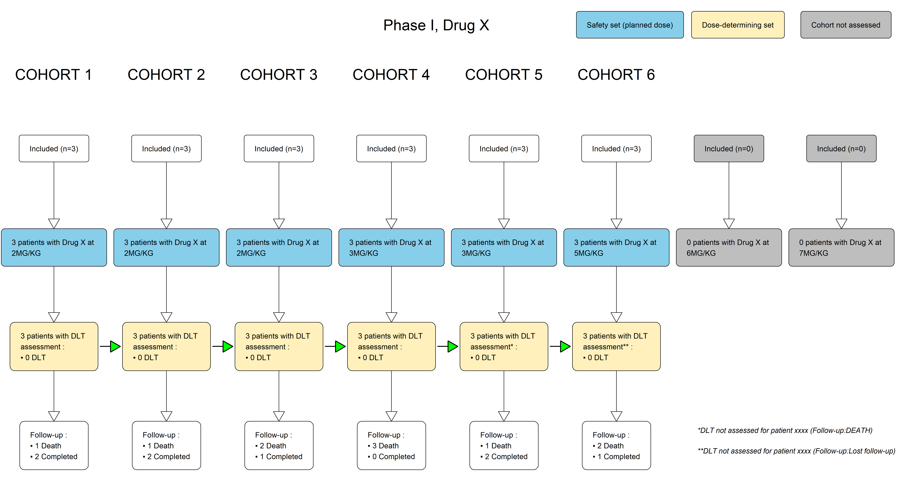
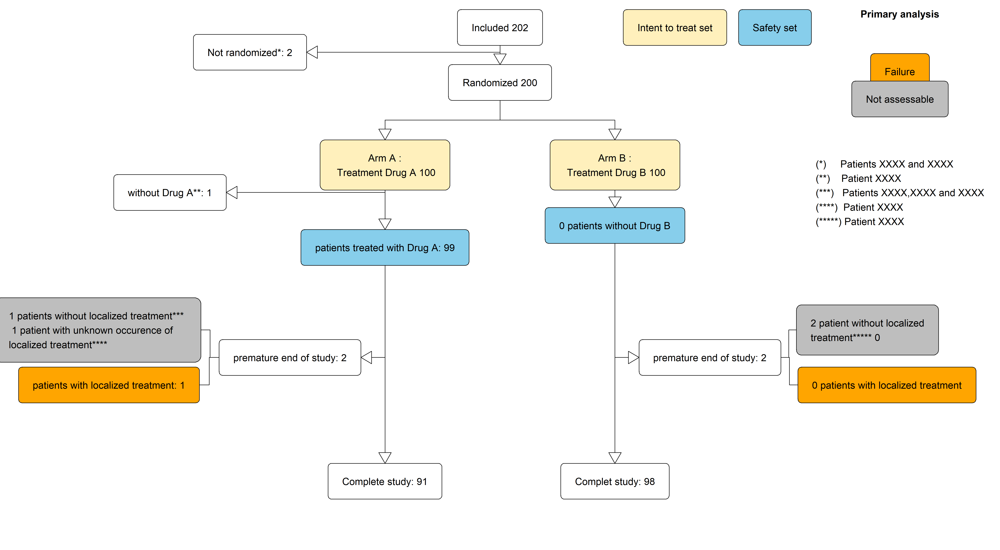
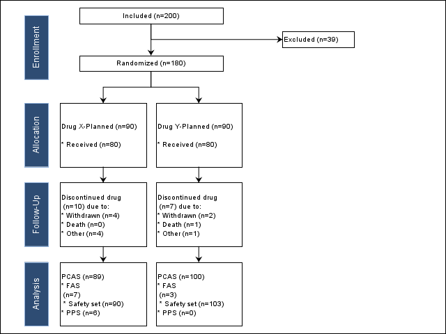

  
<strong>📌 About Us</strong>

  
  <u><strong>Links</strong></u>
  
  Personal website (comming soon)

  **contact:** fleurym@ipc.unicancer.fr
  
  <u>**License**</u>

[Clinical Graphics]{property="dct:title"} by [Maxime FLEURY]{property="cc:attributionName"} is licensed under <a href="https://creativecommons.org/licenses/by-nc-sa/4.0/?ref=chooser-v1" target="_blank" rel="license noopener noreferrer" style="display:inline-block;">CC BY-NC-SA 4.0</a>

<u>**Community**</u> 

[Innostatclinical](https://innostatclinical.com/en/)

<u>**Contributor**</u>

Maxime Fleury, *Author, maintainer* - Health Statistician

<u>**Dev status**</u>

*Vignette creation:* 11/12/2025

*Last update:* 11/12/2025

*Repos status:* Active

# What is a Study flux diagram in clinical trial

In clinical trials, the **flow diagram of study populations** illustrates the path of participants **from their inclusion in the study to the different analysis sets** used for statistical evaluation. This diagram provides a clear **view of the actual numbers involved, the exclusions**, and the potential impact of these changes on the robustness of the analyses.

**In Phase I** *(objective: assess safety, tolerability, and pharmacokinetics)*, the diagram shows the participants included, those who received at least one dose of the investigational product, and any early discontinuations. The focus is on actual exposure, which is essential for defining the safety population.

**In Phase II** *(objective: provide initial evidence of efficacy and refine dosing)*, the diagram displays the participants included, those potentially randomized depending on the study design, those treated, participants with evaluable efficacy data, and the reasons for withdrawal or exclusion from analyses.
For **randomized studies**, the representation must **follow the CONSORT flow diagram**, an international standard structured into four stages (inclusion, allocation, follow‑up, analysis). CONSORT applies only to randomized trials; non‑randomized studies use a standard population flow diagram instead.

  
<strong>Population sets</strong>

  

The ICH E3 and ICH E9 guidelines define several key statistical populations required for regulatory analyses:

<ul>
<li><strong>Primary Criteria Analysis Set:</strong> participants with the necessary data to evaluate the primary efficacy endpoint.</li>

<li><strong>All Patients Set:</strong> all participants included in the study.</li>

<li><strong>Full Analysis Set (FAS):</strong> a population close to the intention‑to‑treat principle, including participants who received at least one dose or who have at least one evaluable efficacy measurement.</li>

<li><strong>Safety Set:</strong> all participants who received at least one administration of the study treatment, forming the basis for safety and tolerability analyses.</li>
</ul>

These elements ensure transparency, methodological consistency, and alignment with international regulatory standards in clinical study reports and scientific publications.

# Exemples

# Exemple

:::: {.panel-tabset}

### Phase I (R)

### Phase II (R)

### Randomized trial (SAS version)

:::

::: {.callout-note}

Graphics has been built with the ADSL table. Data has been generated with [*random.cdisc*](https://insightsengineering.github.io/random.cdisc.data/main/index.html) librairy of the CRAN in R (Version 4.2.0).
:::

::: {.callout-important}

To generate our CONSORT flow diagrams in SAS, we rely on the [open‑source project sas‑consort‑sgplot](https://github.com/srosanba/sas-consort-sgplot/tree/master), available on GitHub. This project provides a simplified implementation of the original SAS programs developed by **Prashant Hebbar and Sanjay Matange**, as presented in their *PharmaSUG 2018 paper* [CONSORT Diagrams with SG Procedures](https://www.lexjansen.com/pharmasug/2018/DV/PharmaSUG-2018-DV24.pdf). Their work demonstrates how to construct publication‑quality CONSORT diagrams using SAS SG procedures and has become a widely referenced approach within the clinical programming community.

The GitHub project sas‑consort‑sgplot builds upon and streamlines the methodology described in the PharmaSUG article, offering a more straightforward and modular set of SAS macros. These improvements facilitate the creation of CONSORT diagrams while reducing programming complexity.

To write this page, we re‑use, adapt, and extend this simplified macro framework to meet the specific constraints of our clinical studies.
:::

# References

- https://github.com/srosanba/sas-consort-sgplot/tree/master

- https://www.lexjansen.com/pharmasug/2018/DV/PharmaSUG-2018-DV24.pdf

