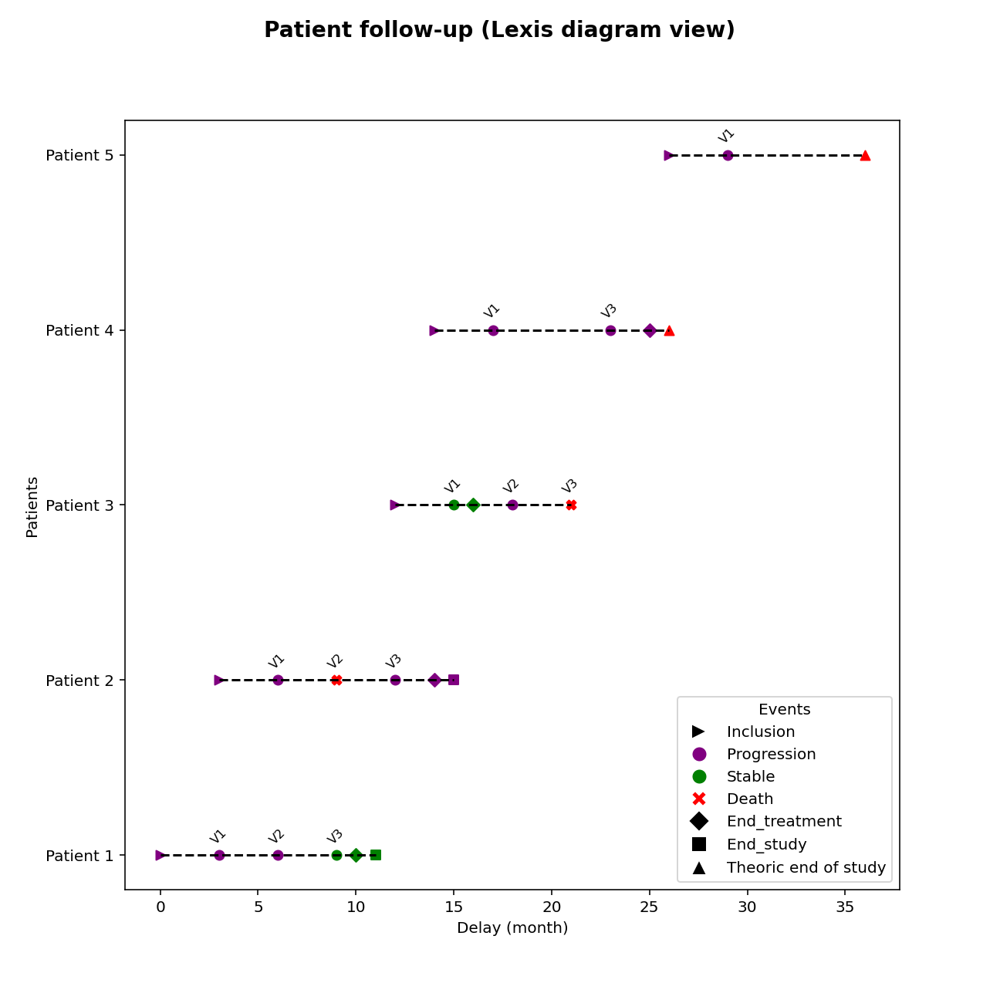

  
<strong>📌 About Us</strong>

  
  <u><strong>Links</strong></u>
  
  Personal website (comming soon)

  Contact (comming soon)
  
  <u>**License**</u>

[Lexis Diagram]{property="dct:title"} by [Maxime FLEURY]{property="cc:attributionName"} is licensed under <a href="https://creativecommons.org/licenses/by-nc-sa/4.0/?ref=chooser-v1" target="_blank" rel="license noopener noreferrer" style="display:inline-block;">CC BY-NC-SA 4.0</a>

<u>**Community**</u> 

Website (comming soon)

<u>**Developers**</u>

Maxime Fleury, *Author, maintainer* - Health Statistician Developers

<u>**Dev status**</u>

*Vignette creation:* 11/12/2025

*Last update:* 11/12/2025

*Repos status:* Active
  

# What is a Lexis diagram: specific use case in clinical trial

The **Lexis diagram** is a highly useful graphical representation in clinical research for tracing and analyzing the history of each patient enrolled in a therapeutic trial. This tool provides an **intuitive, clear, and quick view** of the clinical trial’s evolution, both **overall** and **patient by patient**, making it an invaluable resource for ensuring **data quality and consistency**.

## Why Use a Lexis Diagram

<ul style="list-style-type: disc; padding-left: 60px;">

<li style="margin-bottom: 1em;"><strong>Detect inconsistencies:</strong> Quickly identify data entry errors (incorrect dates, wrong status, missed or delayed visits)</li>

<li style="margin-bottom: 1em;"><strong>Monitor recruitment dynamics:</strong> Visualize the pace of patient enrollment and spot potential delays.
Plot the inclusion curve: In addition to individual timelines, the diagram can display the overall trend of patient recruitment over time</li>

<li style="margin-bottom: 1em;"><strong>Check protocol compliance:</strong> Highlight missed visits, delays in status updates, or deviations from the planned schedule</li>

<li style="margin-bottom: 1em;"><strong>Gain an overview of data quality:</strong> acilitate a global assessment of trial progress and adherence to protocol</li>
</ul>

In summary, the Lexis diagram is a powerful tool to **anticipate issues**, improve **data quality**, and **enhance communication among teams**. Regular use, especially before DSMB meetings, contributes to better trial governance.

## Advantages

<ul style="list-style-type: disc; padding-left: 60px;">

<li style="margin-bottom: 1em;"><strong>Visual clarity and speed:</strong> Summarizes complex information in an intuitive graphic</li>

<li style="margin-bottom: 1em;"><strong>Time-saving:</strong> Enables quick analysis without navigating large tables</li>

<li style="margin-bottom: 1em;"><strong>Monitoring support:</strong> Helps monitoring teams focus on patients or sites requiring special attention</li>

<li style="margin-bottom: 1em;"><strong>Preparation for DSMB meetings:</strong> Before a Data Safety Monitoring Board review, the Lexis diagram provides a consolidated view of inclusions and protocol adherence, enhancing transparency and discussion quality</li>
</ul>

## Limitations

<ul style="list-style-type: disc; padding-left: 60px;">

<li style="margin-bottom: 1em;"><strong>Complexity in large trials:</strong> Readability may decrease with a high number of patients</li>

<li style="margin-bottom: 1em;"><strong>Dependent on data quality:</strong> The diagram is only reliable if data entry is accurate and complete</li>

<li style="margin-bottom: 1em;"><strong>Descriptive tool:</strong> It complements statistical analyses but does not replace them</li>

</ul>

# Exemple

The illustration below presents an example of a Lexis diagram in the context of a cancer clinical trial. Each line corresponds to a patient and highlights key milestones such as the date of inclusion, end of treatment, end of study, scheduled visits, patient status at each visit, and if applicable, the date of death.

On the x-axis (Ox), events are positioned relative to each patient’s inclusion date, while the y-axis (Oy) lists the patients enrolled in the study. A legend clarifies the event types and their associated statuses, ensuring clear and accurate interpretation. We can add more events with differents symbol. 

This figure has been programmed with **Python3** or **SAS**.

:::: {.panel-tabset}

### Python3

### SAS

:::

The figure illustrates the clinical progression of 5 patients enrolled in a cancer clinical trial. Five distinct scenarios are presented:

<ul style="list-style-type: disc; padding-left: 40px; line-height: 1.6; font-family: Arial, sans-serif;">
  <li>**Case 1:** Classic progression of a patient following the protocol schedule, with three visits approximately three months apart and detailed recording of disease status at each event.</li>
  <li>**Case 2:** Demonstrates a potential data entry anomaly, as the patient’s third visit is recorded after death, suggesting a possible error.</li>
  <li>**Case 3:** Typical patient trajectory with treatment completion. The patient initially has stable disease, then progression occurs, followed by death during the trial.</li>
  <li>**Case 4:** Represents incomplete follow-up or missing data, as the patient did not attend the second scheduled visit.</li>
  <li>**Case 5:** Represents a patient recently enrolled in the trial, with only a few events recorded so far.</li>
</ul>

::: {.callout-note}
Data has been generated with [*random.cdisc*](https://insightsengineering.github.io/random.cdisc.data/main/index.html) librairy of the CRAN in R (Version 4.2.0).
:::

# References

- Dahlin S. Exploring the usefulness of Lexis diagrams for quality improvement. BMC Med Inform Decis Mak. 2020 Jan 8;20(1):7. doi: 10.1186/s12911-019-1017-3. PMID: 31915004; PMCID: PMC6950912.

