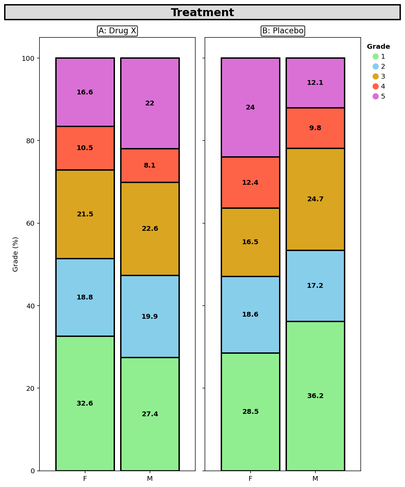
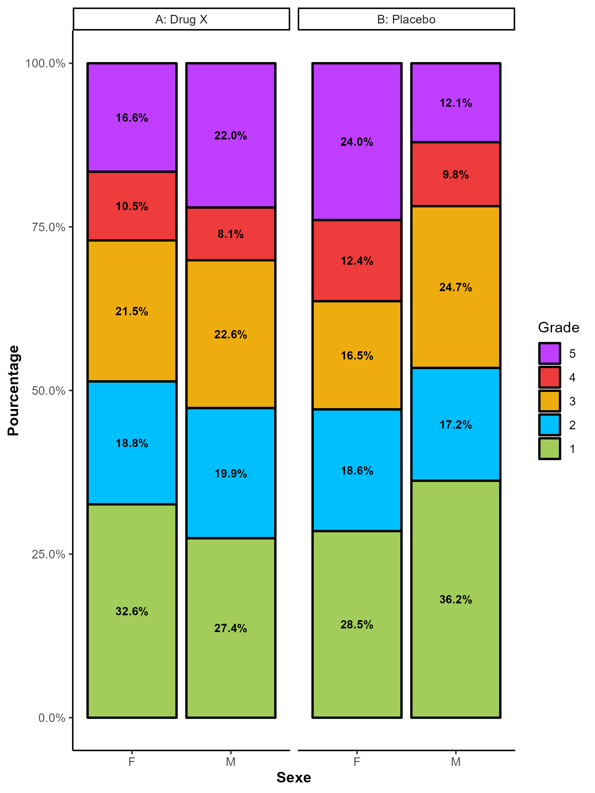
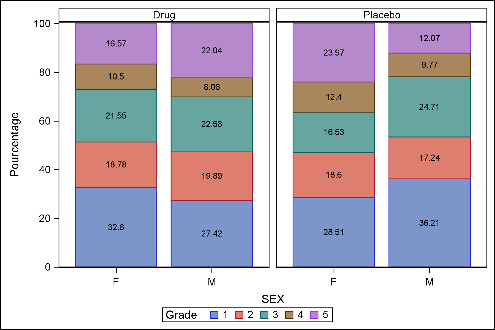
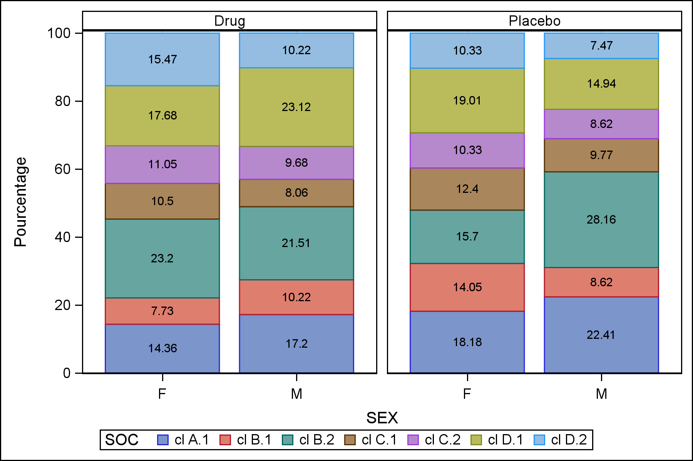

<details style="position: fixed; right: 0; top: 80px; padding: 10px; background: none; width: 350px;">
  <summary style="cursor:pointer;"><strong>📌 About Us</strong></summary>
  
  <u><strong>Links</strong></u>
  
  Personal website (comming soon)

  Contact (comming soon)
  
  <u>**License**</u>

<p xmlns:cc="http://creativecommons.org/ns#" xmlns:dct="http://purl.org/dc/terms/">

[Mosaïc Plot]{property="dct:title"} by [Maxime FLEURY]{property="cc:attributionName"} is licensed under <a href="https://creativecommons.org/licenses/by-nc-sa/4.0/?ref=chooser-v1" target="_blank" rel="license noopener noreferrer" style="display:inline-block;">CC BY-NC-SA 4.0</a>

</p>

<u>**Community**</u> 

Website (comming soon)

<u>**Developers**</u>

Maxime Fleury, *Author, maintainer* - Health Statistician Developers

<u>**Dev status**</u>

*Vignette creation:* 11/12/2025

*Last update:* 11/12/2025

*Repos status:* <span style="color:green">Active</span>
  

</details>


# What is a Mosaïc plot

<div style="text-align: justify;">

A MOSAIC plot is a graphical representation designed to visualize the relationship between multiple categorical variables. It extends the concept of stacked bar charts by using proportional areas:

- **Rectangle dimensions** reflect the frequencies or proportions of category combinations.
- **The X-axis** is divided according to a first categorical variable (e.g., Sex).
- **Grouping** is based on a second variable (e.g., Randomization Arm in a clinical trial).
- **The Y-axis** represents the distribution of a third variable (e.g., CTC-AE toxicity grades) expressed as percentages.

This visualization is particularly useful for **comparing conditional distributions** and identifying associations or imbalances across groups.

</div>


## Specific Use Case: Clinical Trials and Adverse Events (CTC-AE)

<div style="text-align: justify;">

**In clinical trials**, MOSAIC plots can illustrate the **distribution of toxicity grades** (CTC-AE) according to:

- Patient sex (X-axis),
- Randomization arm (grouping),
- and Grades (0 to 5) expressed as percentages (Y-axis).

<details><summary>CTCAE code according to the CTC-AE classification of MEDRA</summary>

- **Grade 1:** Mild
- **Grade 2:** Moderate
- **Grade 3:** Severe
- **Grade 4:** Life-threatening
- **Grade 5:** Death related to adverse event


</details>


This approach allows you to:

- **Quickly visualize safety** profiles across treatment arms,
- **Detect** potential sex-related differences,
- and **communicate** safety data effectively in an intuitive format.

For example a Mosaïc plot showing that, in the experimental arm, females have a higher proportion of grade 2–3 adverse events compared to males may guide further analysis toward specific risk factors.

</div>

## Advantages of MOSAIC plots in this context

<div style="text-align: justify;">

- Visual synthesis of multidimensional data.
- Direct comparison between subgroups.
- Ideal for safety reporting and publications.

</div>

# Exemple


:::: {.panel-tabset}

### Python3



### R



### SAS



:::

Percent class in Mosaic plot can be adjusted on the System Organ Class (SOC) and not on the Percent of Grade. Next exemple present the Mosaic plot according to the System Organ Class.

:::: {.panel-tabset}

### SAS



:::


::: {.callout-note}

Graphics has been built with the ADSL and ADAE tables. Data has been generated with [*random.cdisc*](https://insightsengineering.github.io/random.cdisc.data/main/index.html) librairy of the CRAN in R (Version 4.2.0).
:::

## SAS program

```{r, eval=FALSE, numberLines=TRUE}


# Data Process to compute % by categoricals variables.

proc sql;
    create table df_pct as
    select 
        a.ARM,
        a.SEX,
        a.AEBODSYS,
        count(*) as n,
        calculated n / b.total as pct,
        put(calculated n / b.total * 100, 5.1) || '%' as pct_label
    from adae a
    inner join 
        (select ARM, SEX, count(*) as total
         from adae
         group by ARM, SEX) b
    on a.ARM = b.ARM and a.SEX = b.SEX
    group by a.ARM, a.SEX, a.AEBODSYS, b.total
    ;
quit;

data df_pct;
    set df_pct;
	length pct_label_ 8.;
    pct_label_ = round(pct*100, 0.01); 
run;

# Graphic process. Change ARM, SEX for categorical variable and AEBODSYS for % variable.

ods listing gpath='path\to\save' image_dpi=300 style=listing;
ods graphics / reset width=6in height=4in imagename='MOSAIC';
proc sgpanel data=df_pct;
    panelby ARM / columns=2 novarname spacing=10;
    vbar SEX / response=pct_label_
               group=AEBODSYS
               stat=sum
               seglabel
               datalabelattrs=(weight=bold color=black size=12)
               outlineattrs=(thickness=1);
    rowaxis label="Pourcentage";
    keylegend / title="SOC";
	colaxis grid;
run;
ods graphics off;
ods listing close;


```

# References

- [CDISC ADaM](https://www.cdisc.org/standards/foundational/adam)

- [ADaM Data Structure for Adverse Event Analysis v1.0](https://www.cdisc.org/standards/foundational/adam/adam-data-structure-adverse-event-analysis-v1-0)


