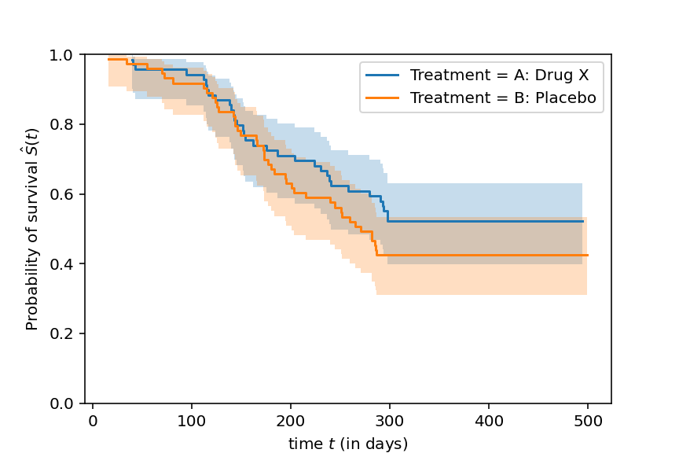
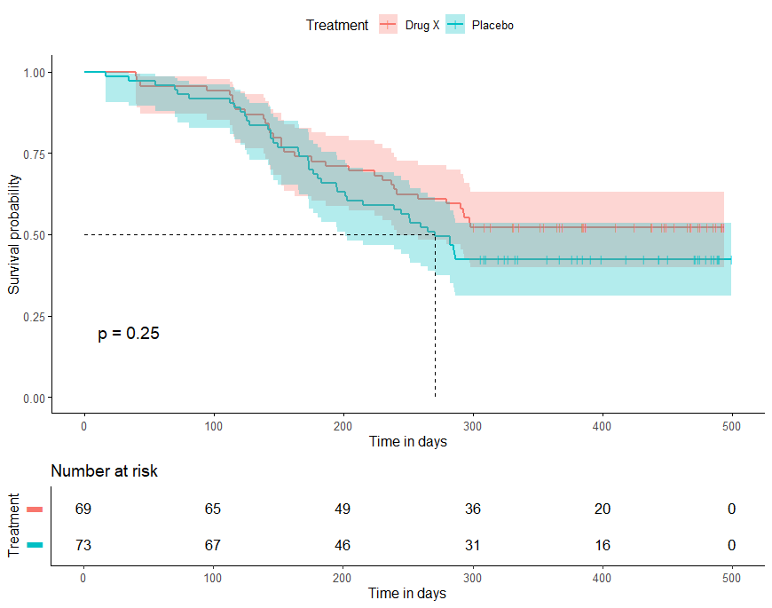
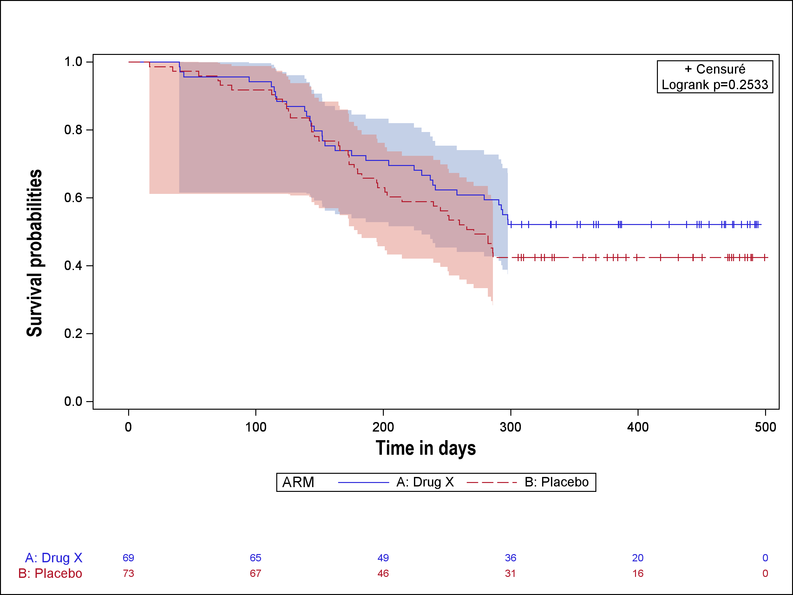

<details style="position: fixed; right: 0; top: 80px; padding: 10px; background: none; width: 350px;">
  <summary style="cursor:pointer;"><strong>📌 About Us</strong></summary>
  
  <u><strong>Links</strong></u>
  
  Personal website (comming soon)

  **contact:** fleurym@ipc.unicancer.fr
  
  <u>**License**</u>

<p xmlns:cc="http://creativecommons.org/ns#" xmlns:dct="http://purl.org/dc/terms/">

[Clinical Graphics]{property="dct:title"} by [Maxime FLEURY]{property="cc:attributionName"} is licensed under <a href="https://creativecommons.org/licenses/by-nc-sa/4.0/?ref=chooser-v1" target="_blank" rel="license noopener noreferrer" style="display:inline-block;">CC BY-NC-SA 4.0</a>

</p>

<u>**Community**</u> 

[Innostatclinical](https://innostatclinical.com/en/)

<u>**Contributor**</u>

Maxime Fleury, *Author, maintainer* - Health Statistician

<u>**Dev status**</u>

*Vignette creation:* 11/12/2025

*Last update:* 11/12/2025

*Repos status:* <span style="color:green">Active</span>

</details>


# What is a survival plot in Clinical Trials


A **survival curve** is a graphical representation that describes, over time, the **probability that an individual from a given population survives** an event of interest. The term survival is used broadly here: it may refer to death, recurrence, disease progression, or any other outcome. This curve allows the visualization not only of the overall level of survival but also of the dynamics of event occurrence throughout the follow‑up period.

**In clinical trials**, the survival curve is often used **to analyze survival outcomes**. The most commonly used method is the **Kaplan–Meier estimator**, which estimates the probability of survival at different time points despite the presence of censored subjects. This curve provides a direct visual comparison between treatment groups, highlighting potential differences in the risk of death over time. It is therefore a key component in evaluating the clinical benefit of a treatment, complementing statistical analyses such as the log‑rank test or the calculation of the hazard ratio.

# Exemple

In this example we present **Kaplan-Meier** curves for Overall Survival.

:::: {.panel-tabset}

### Python3



### R



### SAS



:::


::: {.callout-note}

Graphics has been built with the ADSL and ADTTE tables. Data has been generated with [*random.cdisc*](https://insightsengineering.github.io/random.cdisc.data/main/index.html) librairy of the CRAN in R (Version 4.2.0).
:::

## SAS program

```{r, eval=FALSE, numberLines=TRUE}

proc lifetest data=WORK.surv method=km conftype=loglog plots=survival (cb=hw test atrisk(maxlen=13 outside(0.15)));
	time AVAL*CNSR(0);
	strata ARM / test=logrank;
run;

```

# References

- [CDISC ADaM](https://www.cdisc.org/standards/foundational/adam)

- [ADaM Data Structure for Adverse Event Analysis v1.0](https://www.cdisc.org/standards/foundational/adam/adam-data-structure-adverse-event-analysis-v1-0)


