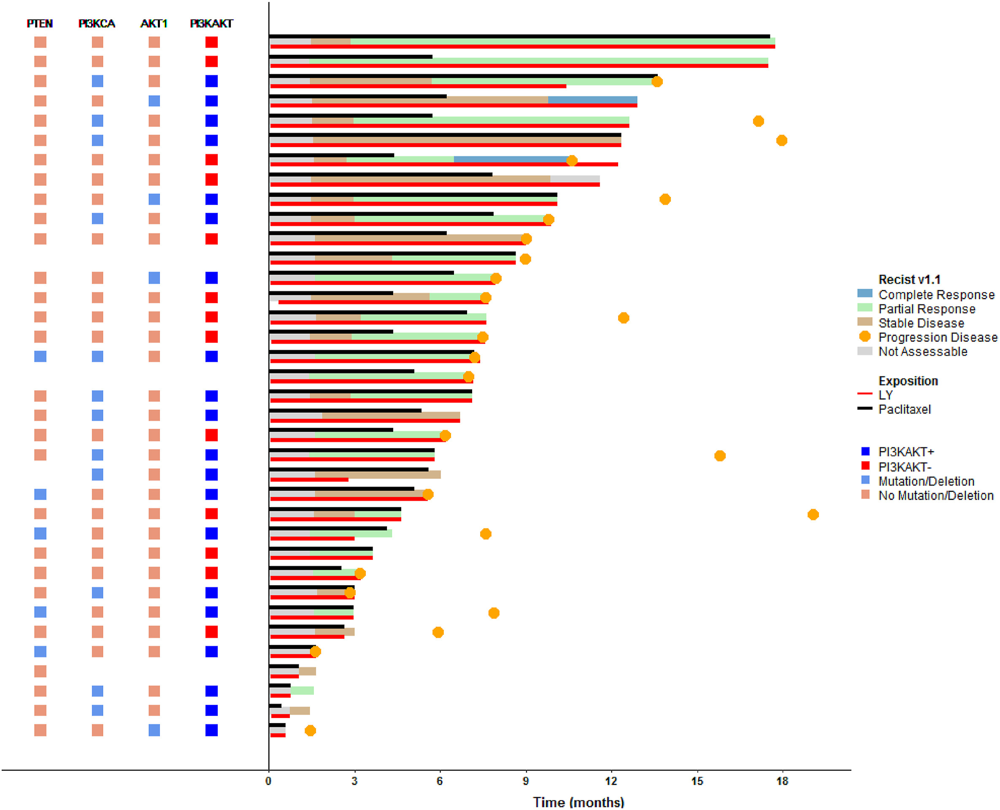
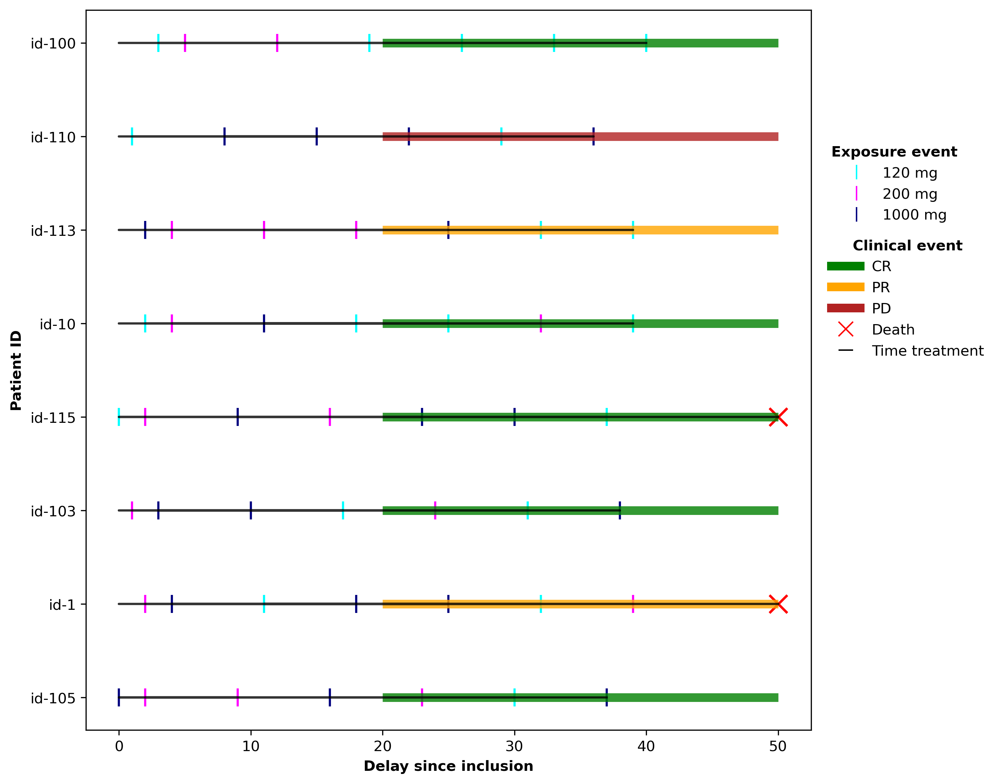
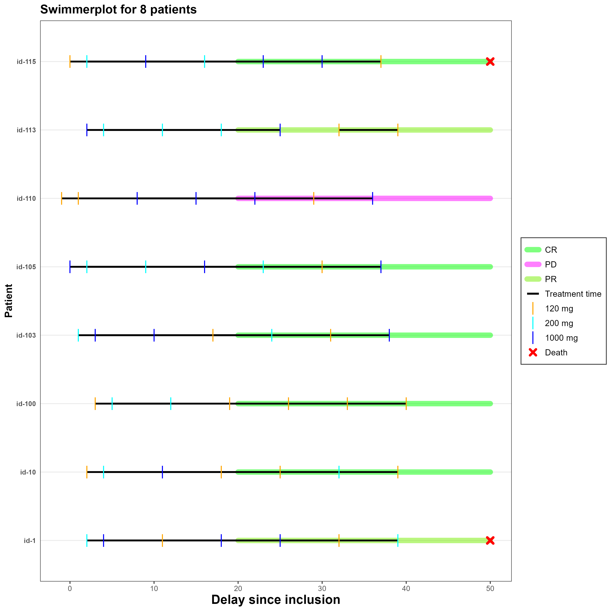
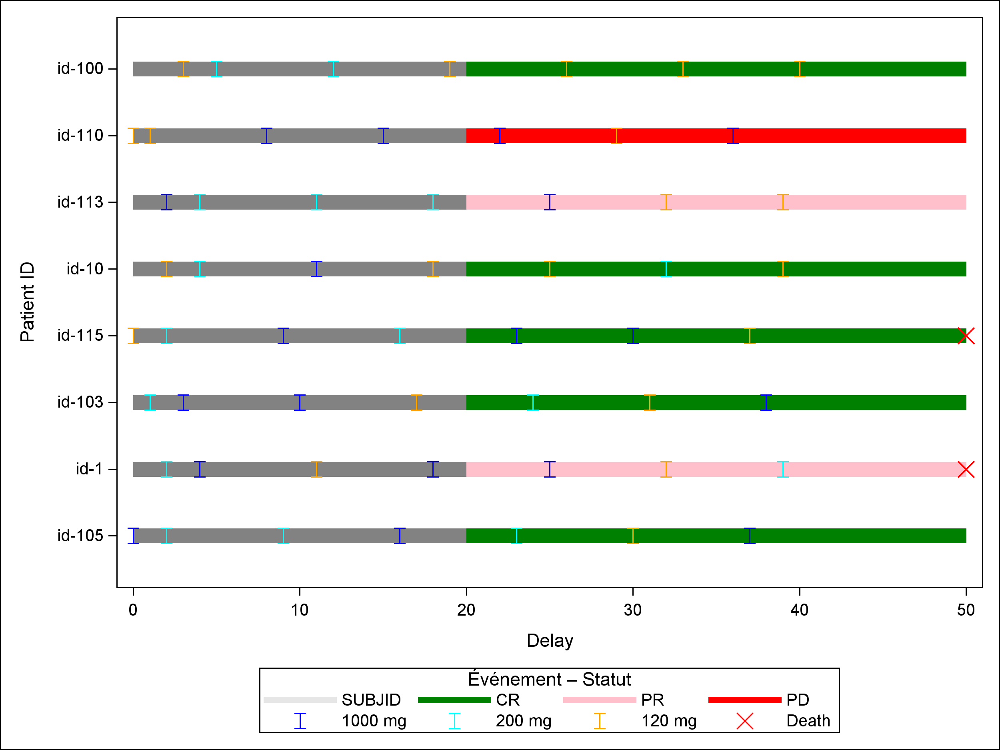

<details style="position: fixed; right: 0; top: 80px; padding: 10px; background: none; width: 350px;">
  <summary style="cursor:pointer;"><strong>📌 About Us</strong></summary>
  
  <u><strong>Links</strong></u>
  
  Personal website (comming soon)

  **contact:** fleurym@ipc.unicancer.fr
  
  <u>**License**</u>

<p xmlns:cc="http://creativecommons.org/ns#" xmlns:dct="http://purl.org/dc/terms/">

[Clinical Graphics]{property="dct:title"} by [Maxime FLEURY]{property="cc:attributionName"} is licensed under <a href="https://creativecommons.org/licenses/by-nc-sa/4.0/?ref=chooser-v1" target="_blank" rel="license noopener noreferrer" style="display:inline-block;">CC BY-NC-SA 4.0</a>

</p>

<u>**Community**</u> 

[Innostatclinical](https://innostatclinical.com/en/)

<u>**Contributor**</u>

Maxime Fleury, *Author, maintainer* - Health Statistician 

Patrick Sfumato, *Author* - Statistician

<u>**Dev status**</u>

*Vignette creation:* 11/12/2025

*Last update:* 11/12/2025

*Repos status:* <span style="color:green">Active</span>
  

</details>


# What is a Swimmer plot

<div style="text-align: justify;">

A **swimmer plot** is a graphical representation used to **visualize the individual progression of each subject in a study over time**. Each horizontal line represents a subject and **illustrates their temporal trajectory**, from study entry to the end of follow‑up. Additional markers or segments can be added to highlight key events, whether short or long in duration, or of different types.

</div>

## Specific Use Case: Clinical Trials (TAKTIC clinical trial exemple)

<div style="text-align: justify;">

In the field of clinical trials, the swimmer plot is primarily used to **depict each patient’s treatment exposure over time**. It clearly highlights the evolution of disease status as well as the **different therapeutic phases, such as treatment cycles, interruptions, dose adjustments, or protocol modifications**.

A representative example of this type of visualization is presented in the **TAKTIC study** (*A prospective, multicentre, uncontrolled, phase IB/II study of LY2780301, a p70S6K/AKT inhibitor, in combination with weekly paclitaxel in HER2‑negative advanced breast cancer patients*). In this study, the swimmer plot illustrates, for each patient, the time on treatment—including exposure to LY2780301 and paclitaxel—RECIST 1.1 response, and the activation status of the PI3K/AKT/PTEN pathway.

</div>




# Exemple

:::: {.panel-tabset}

### Python



### R



### SAS



:::


::: {.callout-note}

Graphics has been built with the ADSL, ADEX and ADRS tables. Data has been generated with [*random.cdisc*](https://insightsengineering.github.io/random.cdisc.data/main/index.html) librairy of the CRAN in R (Version 4.2.0).
:::

## SAS program

```{r, eval=FALSE, numberLines=TRUE}

# Step 1 data process of ADSL, ADEX and ADRS tables.

# Step 2: You must obtain a table with next column: SUBJID | Start study | Lost followUp | StartStatut | DELAY | Value | Attribute

# Step 3: sgplot

ods graphics / reset width=800px height=600px attrpriority=none imagename='SWIMMER_SAS';
proc sgplot data=WORK.swimmer dattrmap=attrmap_evt;
styleattrs datacontrastcolors=(green pink red);
highlow y=SUBJID low=Start_study high=LF / type=LINE lineattrs=(thickness=11 color=gray pattern=Solid)  transparency=0.8;
highlow y=SUBJID low=StartStatut high=LF / type=LINE lineattrs=(thickness=11 pattern=Solid) group=gr;
scatter x=DELAY Y=subjid / group=value attrid=myMap markerattrs=(size=12);
keylegend / title="Événement – Statut";
xaxis label="Delay";
yaxis label="Patient ID";
title "Clinical Dose profil (Swimmer plot)";
run;
ods graphics off;

```


# References


- *Vicier C, Sfumato P, Isambert N, Dalenc F, Robert M, Levy C, Rezai K, Provansal M, Adélaïde J, Garnier S, Guille A, Carbuccia N, Popovici C, Charafe-Jauffret E, Chaffanet M, Birnbaum D, Pakradouni J, Bertucci F, Boher JM, Sabatier R, Gonçalves A*. **TAKTIC:** A prospective, multicentre, uncontrolled, phase IB/II study of LY2780301, a p70S6K/AKT inhibitor, in combination with weekly paclitaxel in HER2-negative advanced breast cancer patients. Eur J Cancer. 2021 Dec;159:205-214. doi: 10.1016/j.ejca.2021.09.040. Epub 2021 Nov 12. PMID: 34781168.


