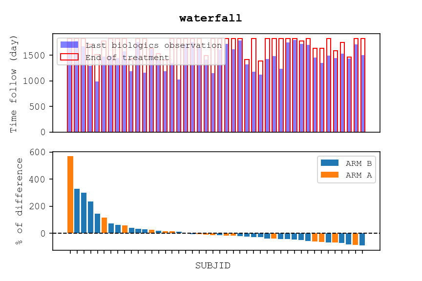
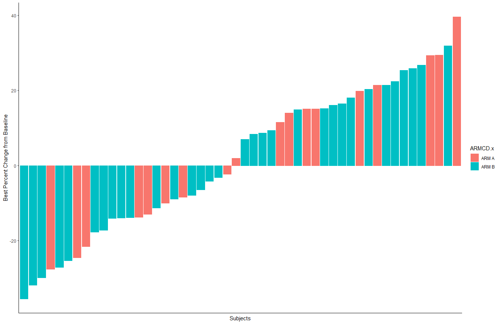
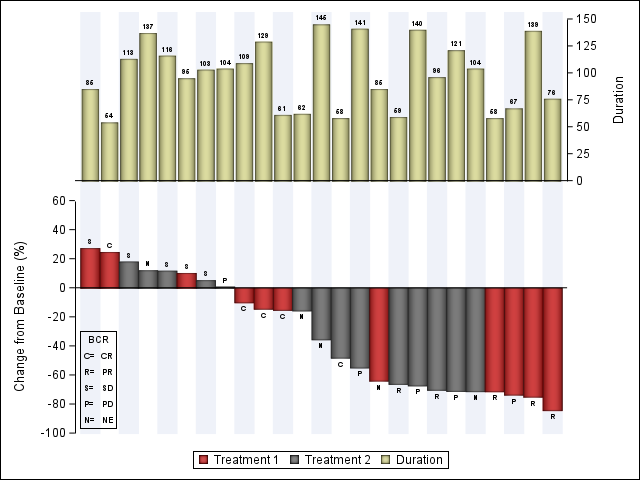

  
<strong>📌 About Us</strong>

  
  <u><strong>Links</strong></u>
  
  Personal website (comming soon)

  **contact:** fleurym@ipc.unicancer.fr
  
  <u>**License**</u>

[Clinical Graphics]{property="dct:title"} by [Maxime FLEURY]{property="cc:attributionName"} is licensed under <a href="https://creativecommons.org/licenses/by-nc-sa/4.0/?ref=chooser-v1" target="_blank" rel="license noopener noreferrer" style="display:inline-block;">CC BY-NC-SA 4.0</a>

<u>**Community**</u> 

[Innostatclinical](https://innostatclinical.com/en/)

<u>**Contributor**</u>

Maxime Fleury, *Author, maintainer* - Health Statistician 

<u>**Dev status**</u>

*Vignette creation:* 11/12/2025

*Last update:* 11/12/2025

*Repos status:* Active
  

# What is a waterfall plot

A **Waterfall** plot is a graphical representation used to visualize, for each subject in a study, the **change in a given measure between two defined time points**: the baseline and a key assessment time. This change can be **positive** (an **increase** in the measured value compared with baseline) or **negative** (a **decrease** in the measured value).

The vertical axis (**y‑axis**) displays the **percentage change** between the key time point and baseline, while the horizontal axis (**x‑axis**) lists the individual **subjects**. This type of visualization is particularly useful for comparing individual treatment responses and quickly identifying heterogeneous response patterns.

## Specific Use Case: Clinical Trials

In oncology, for example, a waterfall plot may be used to present each individual **patient’s response to a particular drug** based on a parameter, such as tumor burden. This graphic can represent the **percent growth or reduction of the tumor by radiologic measurement** (**Gillespie TW**. *Understanding waterfall plots. J Adv Pract Oncol.* 2012 Mar;3(2):106-11. PMID: 25031936; PMCID: PMC4093310.). 

A waterfall plot is very often used to **visualize biological data collected throughout a clinical trial**. It provides a clear and concise **representation of individual variations observed** in biomarkers, pharmacokinetic concentrations, or other biological parameters measured over time.

# Exemple

:::: {.panel-tabset}

### Python

### R

### SAS

:::

::: {.callout-note}

Graphics has been built with the ADSL, ADLB tables. Data has been generated with [*random.cdisc*](https://insightsengineering.github.io/random.cdisc.data/main/index.html) librairy of the CRAN in R (Version 4.2.0).
:::

::: {.callout-important}

SAS graphics was reproducted with data and code generated by [*Sanjay Matange* on Graphically Speaking](https://blogs.sas.com/content/graphicallyspeaking/2017/07/30/clinical-graphs-waterfall-plot/). To see code refer to the [SAS community forum website](https://blogs.sas.com/content/graphicallyspeaking/2017/07/30/clinical-graphs-waterfall-plot/). 
:::

# References

- [https://blogs.sas.com/content/graphicallyspeaking/2017/07/30/clinical-graphs-waterfall-plot/](https://blogs.sas.com/content/graphicallyspeaking/2017/07/30/clinical-graphs-waterfall-plot/)

